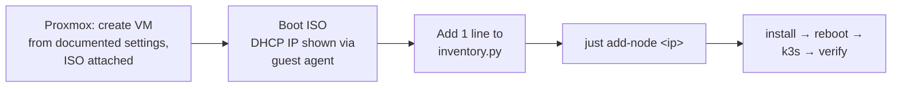

# Design Document

## Overview

pyinfra runs from the operator workstation, inside a project-local uv venv, and drives every node over
SSH. NixOS owns the node's state. Python never configures the system piece by piece. It does three things:

1. renders a small per-node `node.json` from the inventory, the captured host network, and defaults,
2. ships one shared Nix flake plus that `node.json` to the node,
3. runs `nixos-install` (install phase) or `nixos-rebuild switch` (configure phase).

All nodes use the same flake output (`nixosConfigurations.node`). Node differences come only from
`node.json`, so a new node needs an inventory entry and nothing else.

The server node (`kube-01`, 10.0.0.63) is the control plane, a workload node, and the **single entry IP**
for exposed services. Agents only add capacity. Pods are spread across nodes horizontally, without HA
replicas.

```mermaid
flowchart LR
  subgraph WS[Operator workstation]
    INV[inventory.py + group_data] --> PY[uv run pyinfra]
    HN[host_network/*.json] <--> PY
    NIX[nix/ flake + modules] --> PY
    SEC[secrets/ k3s-token, ghcr-token<br/>gitignored] <--> PY
    KC[kubeconfig/kube-ax.yaml<br/>local, gitignored] <-- fetch --- PY
  end
  PY -- SSH nixos@ (live ISO) --> ISO[Install phase<br/>capture DHCP → disko → nixos-install → reboot]
  PY -- SSH ops@ (installed) --> CFG[Configure phase<br/>phase=k3s → nixos-rebuild switch]
  CLIENT[Clients] -- 80/443 + LB ports --> N1
  ISO --> N1
  CFG --> N1[kube-01 10.0.0.63<br/>k3s server + workloads<br/>SQLite · Traefik · servicelb]
  CFG --> N2[kube-02 IP from operator<br/>k3s agent · workloads]
  N1 -- flannel host-gw --> N2
```

### Key decisions

| Decision | Choice | Rationale |
|---|---|---|
| Orchestrator | pyinfra 3.x in a uv venv (`.venv`, `uv.lock`, `.python-version`); `just` from `rust-just` in the same venv | Reproducible, no global install (Req 1) |
| Workstation Nix | None. `nix flake check`/eval in a pinned `nixos/nix` podman container; builds on nodes | Operator has no local Nix (Req 1.2a) |
| Disk layout | disko (pinned flake input): GPT → LVM VG `pool` → LVs `root`, `containerd`, `storage` + free space | Image pulls and PV data can't fill `/`; kubelet sees a separate imagefs; online growth. LVM costs ~nothing in CPU/RAM |
| Config model | One flake output + per-node `node.json` | Inventory is the only source of truth (Req 2.4) |
| Install vs k3s | `node.json.phase = "base" \| "k3s"` | Install finishes before k3s exists (Req 3.8) |
| Node IP | DHCP lease captured on the ISO, then written **static** | IP never moves after install (Req 4.1–4.3) |
| Datastore | Embedded SQLite (kine) on single server | Lowest RAM/CPU. etcd only pays off with ≥3 servers. k3s can migrate SQLite→etcd later with `--cluster-init` |
| CNI backend | flannel `host-gw` | All nodes on one L2 subnet, so no VXLAN encapsulation overhead |
| Entry point | Traefik (1 replica, pinned to server) + servicelb restricted to server | One IP for all services, at the cost of about 100 MiB (Req 11) |
| Metrics | metrics-server kept | Base for the later OpenObserve integration (Req 12) |
| Swap | Small zram (lz4, 25%) as a safety net; pods `NoSwap` | Compression is cheap for idle OS/k3s pages but poor for float arrays and JVM heaps, which also degrade badly when swapped (Req 13.1–13.2) |
| OOM handling | kubelet eviction (memcg notifications) + QoS `oom_score_adj` + MGLRU; no earlyoom/oomd | Kubernetes' built-in earlyoom equivalent; a second killer would fight kubelet (Req 13.9–13.10) |
| Container runtime | k3s embedded containerd + `runc` (no extra RuntimeClass) | Substrate brings gVisor/Kata binaries itself via `SandboxConfig` and runs them inside worker pods (Req 16.1) |
| Agent platform | Agent Substrate + AX from pinned upstream commits, `just platform` | AX needs Substrate. Upstream installers are reused, not re-implemented (Req 16.7) |
| Registry | `ghcr.io` with node-level credentials in `registries.yaml`; no in-cluster registry | No per-namespace pull secrets; no extra service to run (Req 14) |
| Installer | Stock NixOS ISO mounted on the VM + one-time `passwd` → `ssh-copy-id nixos@<ip>` (custom ISO optional later) | Matches the operator's existing Proxmox workflow (Req 3.10) |
| Kubeconfig | Local only, gitignored | The repository is public (Req 9, changed 2026-10-06) |
| Kubelet settings | `KubeletConfiguration` file, not a pile of `--kubelet-arg` flags | Swap, eviction, reservation and CPU manager are typed and kept in one place |
| Build location | On the target node | Workstation needs no Nix. 6 GiB RAM is enough to evaluate/build |

## Architecture

### Repository layout

```
kube-ax-nix-manager/
├── .python-version           # pinned Python for uv
├── pyproject.toml            # uv project: pyinfra 3.x, dev: pytest, ruff
├── uv.lock
├── .venv/                    # created by `uv sync` (gitignored)
├── justfile                  # every recipe runs `uv run …`
├── inventory.py              # hosts, groups: servers, agents
├── group_data/
│   ├── all.py                # admin user, ssh keys, k3s + tuning defaults
│   ├── servers.py            # role = "server", larger kube-reserved
│   └── agents.py             # role = "agent"
├── host_network/             # captured at install; tracked in git (no secrets)
│   └── kube-01.json
├── docs/
│   ├── proxmox.md            # VM template settings (Req 3.12, 13.14)
│   └── workloads.md          # numpy/pandas/Java sizing, OOM layers (Req 15, 13.15)
├── examples/                 # Job/Deployment manifests for Python + Java workloads
├── deploys/
│   ├── install.py            # Phase 1: live ISO → installed NixOS
│   ├── k3s.py                # Phase 2: enable k3s, wait Ready
│   ├── platform.py           # Phase 3: Agent Substrate → AX (pinned commits, ko → ghcr)
│   ├── verify.py             # health, spread test, ingress test, tuning assertions
│   └── kubeconfig.py         # fetch, rewrite, store kubeconfig locally
├── lib/
│   ├── facts.py              # custom pyinfra facts
│   ├── nodeconfig.py         # inventory + host_network + defaults → node.json (validated)
│   └── secrets.py            # local token generation
├── nix/
│   ├── flake.nix             # inputs: nixpkgs (nixos-26.05), disko; outputs: node, installer ISO
│   ├── flake.lock
│   ├── disko.nix             # reads node.json: disk + bootMode
│   └── modules/
│       ├── base.nix          # users, ssh, static networkd, lean OS
│       ├── installer.nix     # custom installer ISO: ssh keys for nixos, sshd, qemu guest agent
│       ├── tuning.nix        # swap mode, sysctls, THP, MGLRU, oomd off, fstrim (Req 13)
│       └── k3s.nix           # services.k3s, kubelet config, Traefik pin, PriorityClasses (phase == "k3s")
├── tests/                    # pytest for lib/
├── kubeconfig/               # gitignored: <cluster>.yaml, ax-deployer.yaml (credentials)
├── .pre-commit-config.yaml   # blocks anything under secrets/
├── platform/
│   ├── versions.toml         # pinned substrate + ax commits, ko/go minimums
│   └── values/               # SandboxConfigs (gvisor, microvm), size0 overrides, node pinning patches
├── secrets/                  # gitignored: k3s-token, ghcr-token, ghcr-push-token
└── .gitignore
```

On each node the flake lives at `/etc/nixos/`. `hardware-configuration.nix` is generated once on the host
and is never overwritten by sync. The flake is referenced as `path:/etc/nixos#node`, so it doesn't need to
be a git repo.

### Operator workflow: from Proxmox VM to cluster node

The operator's manual part ends once the VM is booted from the ISO and reachable over SSH. pyinfra
does everything after that.



1. **Proxmox (manual, once per VM)**: create the VM with the hardware you want. Settings, documented in
   `docs/proxmox.md`:
   - CPU type `host`, ballooning off
   - VirtIO SCSI disk with discard + SSD emulation + IO thread, virtio NIC
   - QEMU Guest Agent enabled (Options), then a full stop/start
   - boot order **disk, then CD-ROM**, with the installer ISO attached
2. **Boot**: the empty disk isn't bootable, so the VM falls through to the mounted stock NixOS ISO. On the
   console, run `passwd` (as `nixos`) and read the IP with `ip -br a`. Then, from the workstation,
   `ssh-copy-id nixos@<ip>`. That copies only the public key; the private key stays local.
   - *Optional later*: `just iso` builds a custom ISO with keys pre-installed, which removes the console
     step.
3. **Inventory**: add `("<ip>", {"node_name": …, "disk": "/dev/sda", "boot_mode": "bios"})` under
   `servers` or `agents`.
4. **`just add-node <ip>`** runs `install` (disk wipe needs `WIPE=/dev/sda` the first time) → reboot.
   The installed disk now boots first, so the ISO can stay attached. Then `k3s` for that node, then
   `verify`.

The optional custom ISO comes from the same flake (`nixosConfigurations.installer`, based on
`installation-cd-minimal.nix` + `modules/installer.nix`), so it is pinned to the same nixpkgs as the nodes.
Without local Nix it builds in the podman Nix container or on kube-01.

### Phase 1 — Install (`deploys/install.py`, SSH as `nixos`)

```mermaid
sequenceDiagram
  participant P as pyinfra (uv venv)
  participant H as Host (live ISO)
  P->>H: facts: IsLiveIso, BootMode, DiskState(disk), PrimaryNetwork, CpuCapabilities
  alt not live ISO
    P-->>P: skip host (already installed) [Req 10.2]
  else no avx2/fma or no vmx/svm or no /dev/kvm
    P-->>P: fail host: set Proxmox CPU type host + nested virt [Req 3.13]
  else DHCP address ≠ inventory address
    P-->>P: fail host [Req 4.1]
  else disk not empty and wipe_disk ≠ disk
    P-->>P: fail host [Req 3.2]
  end
  P->>P: write host_network/<node>.json (addr/prefix, gw, dns, iface, MAC)
  P->>H: upload nix/ + node.json(phase=base) → /tmp/kube-nix
  P->>H: sudo nix run disko -- --mode destroy,format,mount /tmp/kube-nix/disko.nix
  P->>H: sudo nixos-generate-config --no-filesystems --root /mnt
  P->>H: copy /tmp/kube-nix/* → /mnt/etc/nixos (keep hardware-configuration.nix)
  P->>H: sudo nixos-install --flake path:/mnt/etc/nixos#node --no-root-passwd
  P->>H: systemd-run --on-active=3 systemctl reboot
  P->>P: ssh-keygen -R <ip>; wait TCP 22; ssh ops@<ip> true [Req 3.7]
```

**`PrimaryNetwork` fact**: `ip -j route show default` → interface + gateway; `ip -j addr show <iface>` →
address/prefix + MAC; DNS from `resolvectl dns <iface>`, falling back to `/etc/resolv.conf`. For
10.0.0.63 this captures `10.0.0.63/24`, gw `10.0.0.1`, dns `10.0.0.1`, `ens18`, `bc:24:11:a3:c7:ba`.
Inventory overrides (`gateway`, `dns`, `prefix`) win over captured values. `host_network/<node>.json`
is only written once. A re-capture with different values fails unless `recapture_network=True` is passed.

### Phase 2 — Configure k3s (`deploys/k3s.py`, SSH as `ops`)

1. Ensure `secrets/k3s-token` exists locally (64 random hex chars, mode 0600).
2. Upload the token to `/var/lib/k3s-secrets/token` (`root:root 0600`).
3. Sync `nix/` to `/etc/nixos/` (excluding `hardware-configuration.nix`), then render and upload
   `node.json` (`phase=k3s`).
4. `nixos-rebuild switch --flake path:/etc/nixos#node`, only when an uploaded file changed (Req 10.1).
5. Server: wait for `Ready`. Agents: the server confirms the agent is `Ready` (5 min timeout, then
   `journalctl -u k3s -n 100` dump).

Ordering: `just k3s` runs `--limit servers`, then `--limit agents --serial` (Req 6.2, 10.4).

## Components and Interfaces

### `inventory.py`

```python
servers = [
    ("10.0.0.63", {"node_name": "kube-01", "disk": "/dev/sda", "boot_mode": "bios"}),
]
agents = [
    # ("<ip from operator>", {"node_name": "kube-02", "disk": "/dev/sda", "boot_mode": "bios"}),
]
```

### `group_data/all.py` (defaults, overridable per host)

```python
admin_user = "ops"
admin_ssh_keys = [...]  # read from ~/.ssh/*.pub listed here
k3s_disable = []  # keep traefik, servicelb, metrics-server, local-storage
k3s_flannel_backend = "auto"  # host-gw if all nodes share a subnet, else vxlan

# kubelet
system_reserved = {"cpu": "200m", "memory": "256Mi"}
kube_reserved = {"cpu": "200m", "memory": "256Mi"}  # servers.py: memory 512Mi
eviction_hard = {"memory.available": "256Mi", "nodefs.available": "10%", "imagefs.available": "15%"}
eviction_soft = {"memory.available": "512Mi"}
eviction_soft_grace = {"memory.available": "1m30s"}
swap_behavior = "NoSwap"  # pods never swap; "LimitedSwap" opt-in per host
cpu_manager_policy = "none"  # or "static" (requires reserved_cpus)
reserved_cpus = None  # e.g. "0" when static

# host tuning
swap_mode = "zram"  # "zram" | "zswap" | "none"
zram_percent = 25
zram_algorithm = "lz4"  # fast; zstd recompression of idle pages if supported
zswap_swapfile_gb = 4  # only for swap_mode = "zswap"

# registry
ghcr_owner = None  # GitHub user login; None → `gh api user --jq .login`
ghcr_token_file = "secrets/ghcr-token"  # classic PAT read:packages; absent → public images only
ghcr_test_image = None  # e.g. "ghcr.io/<org>/<image>:<tag>" for verify
sysctl_overrides = {}  # merged over tuning.nix defaults
```

### `lib/facts.py`

| Fact | Command | Returns |
|---|---|---|
| `IsLiveIso` | `findmnt -n /nix/.ro-store` | `bool` |
| `BootMode` | `test -d /sys/firmware/efi` | `"uefi" \| "bios"` |
| `DiskState(disk)` | `lsblk -J -o NAME,FSTYPE,PTTYPE <disk>` + `wipefs -n` | `{"empty": bool, "detail": str}` |
| `PrimaryNetwork` | `ip -j route/addr`, `resolvectl` | `{"iface","mac","address","prefix","gateway","dns":[…]}` |
| `K3sNodeReady(name)` | `k3s kubectl get node <name> -o json` | `bool` |
| `CpuCapabilities` | `/proc/cpuinfo` flags, `test -c /dev/kvm` | `{"avx2","fma","avx512f": bool, "kvm": "intel" \| "amd" \| None, "devKvm": bool}` |
| `TuningState` | `swapon --show`, `sysctl -n …`, `systemctl show k3s -p OOMScoreAdjust` | `dict` |

### `node.json` (schema 1)

```json
{
  "schema": 1,
  "phase": "k3s",
  "hostName": "kube-01",
  "disk": "/dev/sda",
  "bootMode": "bios",
  "kvm": "intel",
  "network": { "mac": "bc:24:11:a3:c7:ba", "address": "10.0.0.63/24",
               "gateway": "10.0.0.1", "dns": ["10.0.0.1"] },
  "admin": { "user": "ops", "sshKeys": ["ssh-ed25519 AAAA..."] },
  "tuning": { "swapMode": "zram", "zramPercent": 25, "zramAlgorithm": "lz4",
              "zswapSwapfileGb": 4, "sysctl": {} },
  "k3s": {
    "role": "server",
    "serverAddr": null,
    "nodeIp": "10.0.0.63",
    "tokenFile": "/var/lib/k3s-secrets/token",
    "disable": [],
    "flannelBackend": "host-gw",
    "entryPoint": true,
    "labels": { "topology.kubernetes.io/zone": "kube-01" },
    "kubelet": {
      "systemReserved": {"cpu": "200m", "memory": "256Mi"},
      "kubeReserved":   {"cpu": "200m", "memory": "512Mi"},
      "evictionHard":   {"memory.available": "256Mi", "nodefs.available": "10%", "imagefs.available": "15%"},
      "evictionSoft":   {"memory.available": "512Mi"},
      "evictionSoftGracePeriod": {"memory.available": "1m30s"},
      "swapBehavior": "NoSwap",
      "kernelMemcgNotification": true,
      "cpuManagerPolicy": "none",
      "reservedCpus": null,
      "imageGcHigh": 80, "imageGcLow": 60
    }
  }
}
```

For agents, `serverAddr = "https://10.0.0.63:6443"` and `entryPoint = false`, and the server-only fields
are omitted.

### Nix modules

**`flake.nix`**: inputs `nixpkgs` (`github:NixOS/nixpkgs/nixos-26.05`, matching the ISO) and `disko`.
`nixosConfigurations.node` imports `disko.nixosModules.disko`, `./disko.nix`,
`./hardware-configuration.nix`, and `./modules/*.nix`, with `specialArgs.node = fromJSON (readFile ./node.json)`.

**`disko.nix`**: GPT on `node.disk`, then LVM.
- BIOS: 1 MiB `EF02` BIOS boot partition, then an LVM PV over the rest. GRUB is installed to `node.disk`
  and boots from LVM root; NixOS's `/boot` stays on root.
- UEFI: 512 MiB ESP (`/boot`), then the LVM PV. Uses systemd-boot.
- VG `pool` with ext4 `noatime` LVs: `root` → `/`, `containerd` → `/var/lib/rancher/k3s/agent/containerd`
  (separate imagefs, so kubelet's `imagefs.available` eviction and image GC act on it alone), and
  `storage` → `/var/lib/rancher/k3s/storage` (local-path PVs: Postgres, rustfs, job data).
  Sizes come from `node.diskLayout`; free extents remain for `lvextend -r`.
- No disk swap.

**`modules/base.nix`**
- `networking.hostName`. `networking.useDHCP = false` and `networking.useNetworkd = true`. One
  `systemd.network.networks."10-primary"` matches on the **MAC**, so it doesn't depend on the interface
  name, and sets a static `Address`, `Gateway` and `DNS`.
- `users.users.ops` (wheel, authorized keys), `security.sudo.wheelNeedsPassword = false`.
- `services.openssh`: no password auth, no root login.
- `services.qemuGuest.enable = true`.
- `imports = [ (modulesPath + "/profiles/minimal.nix") (modulesPath + "/profiles/headless.nix") ]`;
  `security.polkit.enable = false`, `services.udisks2.enable = false`, `fonts.fontconfig.enable = false`,
  `xdg.*.enable = false` (Req 17.1). Re-enable anything k3s or Substrate turns out to need.
- No docs: `documentation.enable = false`.
- journald: `SystemMaxUse=200M` (room for a later log shipper).
- `nix.gc` weekly (keep 14d), `auto-optimise-store`, `boot.loader.grub.configurationLimit = 5`.
- `system.stateVersion = "26.05"`.

**`modules/tuning.nix`** (Req 13; every value is `lib.mkDefault`, overridable through `node.tuning`)

```nix
# swapMode = "zram"   (default)
zramSwap = { enable = true; algorithm = "lz4"; memoryPercent = 25; priority = 100; };
swapDevices = [ ];
# swapMode = "zswap"
#   boot.kernelParams += [ "zswap.enabled=1" "zswap.compressor=lz4" "zswap.max_pool_percent=20" "zswap.shrinker_enabled=1" ];
#   swapDevices = [ { device = "/var/lib/swapfile"; size = zswapSwapfileGb * 1024; } ];
# swapMode = "none"   → neither

boot.kernelModules = [ "br_netfilter" "overlay" "tcp_bbr" ]
  ++ [ "kvm-${node.kvm}" ];   # see micro-VM note below
boot.kernelParams  = [ "transparent_hugepage=madvise" "preempt=voluntary" ]
  ++ lib.optional (node.tuning.cpuMitigations == "off") "mitigations=off";
hardware.ksm = { enable = node.tuning.ksm; sleep = 200; };   # knob, default off (Req 17.7)
systemd.tmpfiles.rules = [
  "w /sys/kernel/mm/transparent_hugepage/defrag - - - - defer+madvise"
  "w /sys/kernel/mm/lru_gen/enabled - - - - y"
  "w /sys/kernel/mm/lru_gen/min_ttl_ms - - - - 1000"   # MGLRU thrash protection → OOM instead of thrashing
];

boot.kernel.sysctl = {
  # zram-oriented memory management
  "vm.swappiness" = 100;  "vm.page-cluster" = 0;   # only system pages swap (pods are NoSwap)
  "vm.watermark_boost_factor" = 0;  "vm.watermark_scale_factor" = 125;
  "vm.min_free_kbytes" = 65536;
  "vm.dirty_background_bytes" = 67108864;  "vm.dirty_bytes" = 268435456;
  "vm.max_map_count" = 262144;
  # kubelet expectations
  "vm.overcommit_memory" = 1;  "vm.panic_on_oom" = 0;
  "kernel.panic" = 10;  "kernel.panic_on_oops" = 1;
  "kernel.pid_max" = 4194304;
  # container density
  "fs.inotify.max_user_instances" = 8192;  "fs.inotify.max_user_watches" = 524288;
  "fs.file-max" = 2097152;
  "net.netfilter.nf_conntrack_max" = 262144;
  # networking
  "net.ipv4.ip_forward" = 1;  "net.bridge.bridge-nf-call-iptables" = 1;
  "net.core.default_qdisc" = "fq";  "net.ipv4.tcp_congestion_control" = "bbr";
  "net.core.somaxconn" = 4096;  "net.core.netdev_max_backlog" = 16384;
  "net.ipv4.tcp_max_syn_backlog" = 8192;
  "net.ipv4.ip_local_port_range" = "1024 65000";
  # Agent Substrate / gVisor pod networking (Req 16.2)
  "net.ipv4.conf.all.proxy_arp" = 1;  "net.ipv6.conf.all.proxy_ndp" = 1;
} // node.tuning.sysctl;

systemd.oomd.enable = false;

# Micro-VM sandboxes (Req 16.6, mandatory): node.json "kvm" = "intel" | "amd" from the CpuCapabilities
# fact; nodeconfig refuses to render without it. Set explicitly rather than relying on
# hardware-configuration.nix.
# /dev/kvm is root:kvm 0660; containerd runs as root, so no udev change is needed.
# (merged into the boot.kernelModules list above)
#   ++ [ "kvm-${node.kvm}" ]
services.fstrim.enable = true;
```

**`modules/k3s.nix`** (only when `node.phase == "k3s"`)

- **Kubelet config**: rendered from `node.k3s.kubelet` as a `KubeletConfiguration` and linked (tmpfiles)
  as **drop-in** `/var/lib/rancher/k3s/agent/etc/kubelet.conf.d/99-kube-ax.conf`. k3s writes its own
  defaults as `00-k3s-defaults.conf` there, and drop-ins override a `--config` file, so
  `services.k3s.extraKubeletConfig` (which uses `--kubelet-arg=config=`) could be silently overridden.
  Fields: `failSwapOn: false`, `memorySwap.swapBehavior`, `systemReserved`, `kubeReserved`, `enforceNodeAllocatable: [pods]`, `evictionHard`, `evictionSoft`, `evictionSoftGracePeriod`, `imageGCHighThresholdPercent`, `imageGCLowThresholdPercent`, `kernelMemcgNotification: true`, `serializeImagePulls: false`, `maxParallelImagePulls: 4`, `featureGates` (Substrate set, Req 16.4), `cpuManagerPolicy`, and `reservedSystemCPUs` (only with `static`).
- **services.k3s**: `enable`, `role`, `tokenFile`, `serverAddr` (agents),
  `extraFlags = [ "--node-ip=…" ] ++ node labels ++ (server-only:
  "--advertise-address", "--tls-san", "--flannel-backend", "--disable-cloud-controller",
  "--write-kubeconfig-mode=0600", "--disable=<x>"…,
  "--kube-apiserver-arg=feature-gates=ClusterTrustBundle=true,ClusterTrustBundleProjection=true,PodCertificateRequest=true",
  "--kube-apiserver-arg=runtime-config=certificates.k8s.io/v1beta1=true")`.
- **k3s package**: `pkgs.k3s_1_36` (1.36.4+k3s1). nixos-26.05's default `k3s` is 1.35.8, below Substrate's
  supported range (1.37 latest stable, 1.36 previous). `k3s_1_36` ships in the same nixpkgs, so no extra
  input is needed (Req 16.3). Move to `k3s_1_37` when nixpkgs has it.
- **Entry point (server, `entryPoint = true`)**:
  - Node label `svccontroller.k3s.cattle.io/enablelb=true` goes on the server only. Once any node carries
    this label, servicelb runs LoadBalancer pods only on labelled nodes, so LB ports open on the server IP
    only (Req 11.1).
  - A `HelmChartConfig` for `traefik` in `kube-system`, placed in
    `/var/lib/rancher/k3s/server/manifests/traefik-config.yaml` (via `services.k3s.manifests` if the
    pinned module has it, else `systemd.tmpfiles`), sets `deployment.replicas: 1` and
    `nodeSelector: kubernetes.io/hostname: kube-01` (Req 11.2).
- **PriorityClasses** (server, Req 15.2): `batch-low` (value 1000) and `service-default` (value 10000,
  `globalDefault: false`) in the server manifests directory.
- **ghcr credentials** (Req 14): not part of Nix, because they would end up in the store. `deploys/k3s.py`
  writes `/etc/rancher/k3s/registries.yaml` (root 0600) when `secrets/ghcr-token` exists:
  `configs: { "ghcr.io": { auth: { username: <github user>, password: <token> } } }`. When that file
  changes, the deploy runs `systemctl restart k3s` on that node only.
- **k3s unit hardening** (Req 13.8): `systemd.services.k3s.serviceConfig = { OOMScoreAdjust = -999;
  CPUWeight = 1000; IOWeight = 1000; }`. `kubepods.slice` keeps the default weight of 100.
- **Firewall**: all nodes allow TCP 10250 and `trustedInterfaces = [ "cni0" "flannel.1" ]`. The server
  also allows TCP 6443, 80 and 443. UDP 8472 is opened only with `vxlan`. The NixOS firewall must not
  block the LB ports servicelb opens: k3s programs its own iptables chains for those. Task 3.5 verifies
  this, and falls back to `allowedTCPPortRanges` for a configured LB range if needed.

> Task 3.5 checks option names and types against the pinned nixpkgs 26.05 `services.k3s` module
> (`extraFlags` list vs string, `manifests`, `tokenFile`, `serverAddr`). It also checks that the bundled k3s
> version supports `NodeSwap`/`LimitedSwap`, which needs cgroup v2 (the NixOS default).

### Phase 3 — Platform: Agent Substrate + AX (`deploys/platform.py`, runs locally)

This phase runs on the workstation against the cluster API, not on the nodes over SSH. It still lives in
pyinfra, using `@local` and the local kubeconfig, so the inventory, data and secrets stay in one tool.

1. **Preflight**: local tools (`go`, `kubectl`, `make`, `git`) at the minimums in
   `platform/versions.toml`. `ko` is installed at its pinned version into `.cache/bin`. The cluster Kubernetes version is within Substrate's range. The feature gates
   are on (probe `kubectl api-resources | grep -i clustertrustbundle`). `ko login ghcr.io` with
   `secrets/ghcr-push-token`.
2. **Checkout**: shallow-fetch `agent-substrate/substrate` and `google/ax` at the pinned commits into
   `.cache/platform/` (gitignored).
3. **Substrate**: run `hack/install-microvm-deps.sh --install`, then
   `hack/install-ate.sh --deploy-ate-system --cluster-size size0 --setup-csi=none` (no demos, no benchmarks;
   later `--otlp-endpoint <openobserve>`) with
   `KO_DOCKER_REPO=ghcr.io/<ghcr_owner>/substrate`, `--image-label
   org.opencontainers.image.source=https://github.com/<ghcr_owner>/<this repo>`, `BUCKET_NAME=ate-snapshots`, the generic (non-kind,
   non-GCP) path, and in-cluster PostgreSQL + rustfs. PostgreSQL and rustfs get a `nodeSelector` for the
   server node, applied by the installer's flags if it has them, otherwise by `kubectl patch` from
   `platform/values/`.
4. **SandboxConfigs**: apply both `microvm` (default class for AX) and `gvisor`. Fail first if any Ready
   node doesn't advertise `/dev/kvm` through atelet.
5. **AX**: `make deploy AX_IMAGE_REPO=ghcr.io/<ghcr_owner>/ax` (same source label) → `ax-system`. Install the `ax` CLI locally
   (`go install …/cmd/ax@<pinned>`).
6. **Smoke test**: covered by verify (Req 16.11).

Initial pins (from the operator's `hyperland-forky-worker-vm`, which already builds the `ax` CLI): AX
`v0.3.1`, built with Go toolchain `go1.27.1` (`GOTOOLCHAIN` fetches it checksum-verified; the workstation
has Go 1.26.8). The Substrate commit gets pinned in task 10.1.

Upstream install scripts change quickly. Pinning both commits in `platform/versions.toml` and bumping them
on purpose (`just platform-bump`) keeps reinstalls reproducible.

Package visibility: images pushed to ghcr are private by default. The nodes' read token (Req 14) covers
the same owner, so no extra pull secret is needed.

### `justfile` interface (every recipe uses `uv run`)

| Recipe | Command |
|---|---|
| `just setup` | `uv sync` (creates `.venv` from `uv.lock`) |
| `just iso` | *(optional)* build the installer ISO in the podman Nix container or on kube-01 |
| `just nix-check` | `podman run --rm -v ./nix:/src:ro nixos/nix:<pinned> nix flake check …` + eval of fixture node.json files |
| `just install HOST [WIPE]` | `uv run pyinfra inventory.py deploys/install.py --limit HOST --user nixos --data wipe_disk=WIPE` |
| `just k3s [HOST]` | servers first, then agents `--serial` (or only `HOST`) |
| `just platform` | Phase 3: Substrate → SandboxConfigs → AX |
| `just verify` | `uv run pyinfra inventory.py deploys/verify.py` |
| `just kubeconfig` | fetch → `kubeconfig/<cluster>.yaml` (local, gitignored) |
| `just kubectl ARGS` | `KUBECONFIG=kubeconfig/<cluster>.yaml kubectl ARGS`  |
| `just add-node HOST` | `install HOST` → `k3s HOST` → `verify` |
| `just test` | `uv run pytest && uv run ruff check` |

## Customisation knobs (Req 17.4)

All knobs live in `group_data/all.py` (cluster defaults) and can be overridden per host in `inventory.py`.

| Knob | Default | Effect | Change when |
|---|---|---|---|
| `swap_mode` | `zram` | `zram` / `zswap` (+ swapfile) / `none` | `none` if zram CPU cost shows up in footprint reports |
| `zram_percent`, `zram_algorithm` | 25, `lz4` | Size/speed of compressed swap | Raise only if OS/idle pages hit swap often |
| `swap_behavior` | `NoSwap` | Pods never swap | `LimitedSwap` for memory-spiky Burstable jobs that tolerate slowdowns |
| `system_reserved`, `kube_reserved` | 256Mi / 256–512Mi, 200m each | Protects OS + k3s from pods | Lower after footprint shows headroom |
| `eviction_soft` / `eviction_hard` | 512Mi (1m30s) / 256Mi | When kubelet starts evicting | Larger nodes → scale up |
| `cpu_manager_policy` | `none` | `static` = exclusive cores for Guaranteed integer-CPU pods | Nodes with ≥ 6 vCPU running BLAS/JVM-heavy pods |
| `k3s_disable` | `[]` | Drop bundled components | `traefik` if only LoadBalancer services are used (~50–100 MiB) |
| `traefik_replicas` | 1 | Ingress on server | Never above 1 here |
| `ksm` | off | Merge identical pages (micro-VM guests) | Turn on if footprint shows many similar micro-VMs; keep only if `pages_sharing` is significant |
| `kernel_preempt` | `voluntary` | Throughput over latency | `full` only for latency-sensitive services |
| `cpu_mitigations` | `auto` (on) | Spectre/MDS/etc. mitigations | `off` only if no untrusted agent code runs, for syscall-heavy speed-ups |
| `cpuidle_haltpoll` | off | Idle vCPUs poll before halting: lower wake-up latency | Latency-sensitive services, when the host has spare CPU |
| `soft_lockup_watchdog` | off | Kernel soft-lockup detector | Turn on only while debugging real lockups |
| `nofile_soft` / `nofile_hard` | 65536 / 524288 | systemd default open-file limits | Raise for very connection-heavy services |
| `substrate_warm_workers` | 1 per class per node | Idle sandbox pods kept warm | Raise for lower AX task start latency |

## Data Models

- **Inventory host data**: required `node_name`, `disk`, `boot_mode`, plus the group-derived `role`.
  Everything else defaults from `group_data`.
- **`host_network/<node>.json`**: captured network identity; reviewed and committed.
- **`node.json`**: the only interface between pyinfra and Nix, validated in `lib/nodeconfig.py`.
- **Secrets**: `secrets/k3s-token` and `secrets/ghcr-token` (0600, gitignored). On nodes the token lives
  at `/var/lib/k3s-secrets/token` (root 0600) and is never part of the Nix store.
- **Kubeconfig** (`kubeconfig/<cluster>.yaml`, local, gitignored): the server URL is rewritten to the server IP,
  and names are changed from `default` to the cluster name so it merges cleanly with other kubeconfigs.
  `deploys/kubeconfig.py` compares content before writing (k3s rotates the client cert yearly, so a new
  commit appears roughly once a year). It commits with `git commit -- kubeconfig/<cluster>.yaml` (pathspec,
  so nothing else that's staged gets swept in) and never pushes.

## Resource budget (3 vCPU / ~6 GiB VMs)

| Item | Server node | Agent node |
|---|---|---|
| Base NixOS idle | ≤ 250 MiB | ≤ 250 MiB |
| k3s process (control plane on server, kubelet, containerd) | ≤ 700 MiB | ≤ 300 MiB |
| Add-ons: CoreDNS, metrics-server, local-path, Traefik, svclb | ~220 MiB | – |
| Reserved (system + kube) | 768 MiB / 400m CPU | 512 MiB / 400m CPU |
| Hard eviction floor | 256 MiB | 256 MiB |
| Headroom for a future collector DaemonSet pod (Req 12.3) | ~100 MiB / 100m | ~100 MiB / 100m |
| **Allocatable to pods** | **≈ 4.8 GiB** | **≈ 5.1 GiB** |
| Micro-VM overhead per running actor (Cloud Hypervisor + guest kernel; actor minimum 256 MiB) | ~30–60 MiB VMM + guest RAM | same |
| Agent Substrate + AX (PostgreSQL, rustfs, Prometheus, OTel Collector, Jaeger, Envoy, ateapi, atenet, AX controller) | **unknown, estimated 1.5–2.5 GiB**, mostly on the server | atelet DaemonSet + warm worker pods |
| zram (25% RAM, lz4 ~2:1 on OS/idle pages; pods don't swap) | ~1.5 GiB logical for ≤ ~0.75 GiB physical | same |

The Substrate/AX footprint is unmeasured upstream for small clusters. Task 11 measures it. If the server
node drops below ~2 GiB allocatable for jobs, the options are: raise the VM's RAM; move Prometheus/Jaeger
to OpenObserve early; or shrink the warm worker pool sizes.

On 3 vCPU the `static` CPU manager could give at most 2 exclusive cores. It stays `none` by default and
becomes more useful on larger nodes added later.

## Error Handling

| Situation | Behaviour |
|---|---|
| Missing inventory field | `nodeconfig.render` raises before any operation; the host fails with the field name |
| Host not on live ISO during `install` | Host skipped: "already installed" (Req 10.2) |
| DHCP address ≠ inventory address | Host fails, showing both addresses |
| Captured network differs from committed `host_network` file | Fails unless `recapture_network=True` |
| Disk not empty, `wipe_disk` ≠ disk path | Host fails, prints `lsblk` |
| Boot mode mismatch | Host fails before disko runs |
| CPU lacks AVX2/FMA or vmx/svm, or no `/dev/kvm` | Host fails before disko runs, with the Proxmox fix: CPU type `host`, `kvm_intel nested=1`/`kvm_amd nested=1`, VM restart |
| No internet on ISO | Command fails with a hint. Re-running is safe because disko re-wipes with the flag |
| `nixos-install` fails | `/mnt` left mounted for debugging |
| Host key changed after reboot | `ssh-keygen -R` + `accept-new` |
| SSH not back within 10 min | Fail with hint: check VM boot order (disk before ISO) |
| `nixos-rebuild switch` fails | Previous generation stays active |
| Node not Ready in time | Fail, dump `journalctl -u k3s -n 100` |
| kubelet refuses to start with swap | Detected by verify/Ready timeout; the hint points at `failSwapOn`/k3s version (Task 3.5) |
| Substrate installer expects kind/GKE-only bits | Preflight fails with the missing piece; add an override under `platform/values/` rather than editing upstream |
| k3s too old for Substrate feature gates | Preflight fails; switch `services.k3s.package` to the pinned newer input (Req 16.3) |
| ghcr pull fails (401/403) | verify reports per node; hint: token scope `read:packages`, package visibility |
| SSH to ISO fails (stock ISO, no key) | install fails fast with hint: `passwd` on the console, then `ssh-copy-id nixos@<ip>` |
| IP later leased to another device by DHCP | Not detectable by the node. The README requires a DHCP reservation or exclusion (Req 4.4) |

## Testing Strategy

1. **Static checks**: `uv run ruff check`; `nix flake check` and an eval of
   `nixosConfigurations.node.config.system.build.toplevel.drvPath` for fixture `node.json` files
   (server/bios, agent/uefi, static CPU manager, NoSwap).
2. **Unit tests** (`uv run pytest`): nodeconfig validation, network capture merge/override, flannel
   auto-selection, server vs. agent shaping, kubelet config rendering, token generation.
3. **Dry run**: `uv run pyinfra … --dry` against the live ISO before touching the disk.
4. **End-to-end**: install + `k3s` + `verify` on kube-01. Then `just add-node <ip>` for the second VM
   (Req 10.3).
5. **Verify deploy assertions**:
   - nodes Ready
   - spread test (Req 8.4)
   - ingress through the server IP to a pod on an agent (Req 11.4)
   - LB port not open on agents
   - zram active, sysctls at their values, k3s `OOMScoreAdjust=-999` (Req 13.15)
   - RAM/RSS vs. budget
6. **Memory-pressure smoke test** (manual, documented): run `batch-low` Burstable pods with
   `stress-ng --vm` that push the node past the soft eviction threshold. Confirm they are **evicted** by
   kubelet (not killed by the global OOM killer), pods never swap, and the node, k3s and SSH stay
   responsive.
7. **Idempotency**: a second `just k3s` reports 0 changes and the k3s `ActiveEnterTimestamp` is unchanged.

## Operations additions (2026-10-05/06)

### Egress routes (Req 19, 23)

`tools/egress-watcher` reads `routes.json` (ConfigMap `egress-watcher-routes`, from
`platform/substrate/egress-routes/{scoped,open}.json`): a list of `{prefix, policy}`. Each new actor in
atespace `default` gets the policy of the longest matching prefix, created once and never changed;
`null` or no match means no policy, so no egress. Parsing is strict (unknown fields, duplicate prefixes,
empty policies fail). Live: `scoped.json`; `ousast-engine-` without a listed sub-prefix → no egress.
The NetworkPolicy on the egress gateway still caps everything to public IPv4, TCP 443.
`scripts/egress-test.py {open,scoped}` proves the routes end to end (real TLS handshakes per prefix;
the gateway's own `403 egress denied` counts as blocked).

### Reaper (Req 23.1)

`tools/ax-reaper` (Deployment in `ax-system`, 16 Mi): every minute `ListTasks` (AX gRPC), worker pod logs
(last 2 h, `pods/log` read in `ax-workers`), exit line per `ate.actor.name` newer than the task's
`creation_timestamp`, `DeleteTask` after 10 min.

### Disk layout and cleanup order (Req 21)

```text
/ (root LV, 20G)          OS, journal (200M), k3s server state     kubelet nodefs eviction at 10 % free
containerd LV (35G)       container images                          kubelet image GC 80 % -> 60 %
  └ ate/ -> /var/lib/ate  actor image cache (cap 10 GiB), /workspace atelet: cap, then 75 % -> 65 %
                                                                    kubelet imagefs eviction at 15 % free
```

### Substrate upgrade (Req 22)

Pin in `scripts/platform.sh` (`SUB_TAG`, `SUB_COMMIT`) and `platform/versions.toml`; `just platform
checkout patch images` prepares; `scripts/substrate-upgrade.sh OLD` switches (see `docs/upgrading-substrate.md`).

## Open Questions

0. ~~Proxmox CPU type~~: **resolved**. `host` + nested virtualisation is required on every node; kube-01
   verified on 2026-10-04 (i7-8700, AVX2/FMA, vmx, `/dev/kvm`). Apply the same to every future VM.

1. **Second node IP**: to be supplied by the operator; the inventory entry is commented out until then.
2. ~~Kubeconfig encryption~~: **resolved**, not committed at all (public repo, 2026-10-06).
3. ~~`ghcr_owner`~~: **resolved**, `norandom`. Repo `github.com/norandom/kube-ax-nix-manager` (public from 2026-10-06) is
   the source repo the images link to. The push uses `gh auth token` once it has `write:packages`; nodes
   pull with a separate read-only classic PAT.
4. ~~Local Nix~~: **resolved**, none. Nix checks run in podman; the stock ISO is the default.
5. **Hypervisor settings**: confirm the Proxmox VMs can use CPU type `host`, ballooning off, and
   discard on disks (Req 13.14).
