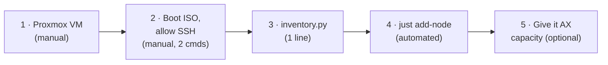

# Adding a node

**Summary:** prepare a Proxmox VM (5 minutes, by hand), boot the NixOS ISO and allow SSH (2 commands), add
one line to `inventory.py`, then run **one command**. The automation checks everything first, installs NixOS,
joins k3s and runs the cluster checks. kube-02 was added this way on 2026-10-04.

## The process at a glance



## 1. Prepare the VM in Proxmox

| Setting | Value | Why |
|---|---|---|
| CPU | **type `host`**, 4 cores | AVX2/FMA for numpy and the JVM; vmx for nested KVM. The install **refuses** a CPU without them |
| Memory | **8192 MiB, ballooning device on, minimum = 8192** | Kubernetes needs a fixed RAM size |
| Disk | VirtIO SCSI, ≥ 100 GiB, **discard + SSD emulation**, IO thread | The disk must be **blank**; LVM layout uses 85 GiB, the rest stays free |
| Network | virtio, same network as the others (10.0.0.0/24) | flannel host-gw needs one shared network |
| Options | **QEMU Guest Agent: enabled** | Shows the IP in Proxmox |
| Boot order | **disk first, then CD-ROM**, NixOS 26.05 ISO attached | An empty disk falls through to the ISO; after install the disk boots, and the ISO can stay attached |
| Proxmox host | `kvm_intel` nested = `Y` (check `/sys/module/kvm_intel/parameters/nested`) | Already true on this host |

Also **reserve the VM's DHCP address** in your router. The install pins that address statically.

## 2. Boot the ISO and allow SSH

Start the VM; it boots the live ISO. On its console:

```bash
passwd                 # set a throwaway password for the user "nixos"
ip -br a               # note the IP address
```

From your workstation (copies only your **public** key):

```bash
ssh-copy-id nixos@<ip>
ssh nixos@<ip> true    # must succeed without a password prompt
```

## 3. Add the node to the inventory

In `inventory.py`, under `agents` (the cluster has exactly one server):

```python
agents = [
    ("10.0.0.58", {"node_name": "kube-02", "disk": "/dev/sda", "boot_mode": "bios"}),
    ("10.0.0.xx", {"node_name": "kube-03", "disk": "/dev/sda", "boot_mode": "bios"}),  # new
]
```

Optional dry check, which changes nothing and prints what the automation sees and plans:

```bash
uv run just probe 10.0.0.xx
```

## 4. Run the automation

```bash
uv run just add-node 10.0.0.xx
```

What it does, and what stops it:

| Step | What happens | Stops (before changing anything) if… |
|---|---|---|
| Prechecks | confirms the live ISO, boot mode, blank disk, AVX2/FMA/vmx and `/dev/kvm`, and that the DHCP address matches the inventory | any of them fails; the error says what to fix in Proxmox |
| Network capture | saves IP, gateway, DNS and MAC to `host_network/<node>.json` | a previous capture differs (deliberate change: `--data recapture_network=True`) |
| Install | disk layout (GPT + LVM), `nixos-install` from this repo's flake, reboot, waits for SSH as `ops` | — |
| Join k3s | uploads the cluster token, switches NixOS to the k3s configuration, waits until the node is Ready | not Ready within 5 min (prints the k3s journal) |
| Verify | `just verify` across all nodes (38 checks) | any check fails |

If the disk isn't blank, the install refuses unless you name the disk explicitly:
`uv run just add-node 10.0.0.xx /dev/sda`. That **wipes** it.

## 5. Give the node AX capacity (optional)

A new node runs ordinary Kubernetes pods immediately. To also run **AX tasks** on it, add a WorkerPool for
it to `platform/substrate/workerpools.yaml` (copy a `compute-kube-0x` block, change the name and the
`kubernetes.io/hostname`), then:

```bash
uv run just platform pools
```

Size the pool like the others: one engine task (1.7 GB heap, ~2.5 GiB total) per worker, 3 GiB, and keep
≥ 0.75 GiB free above kubelet's eviction threshold (see [optimizations](optimizations.md#2-memory)).

## Afterwards

- **Commit** `inventory.py` and `host_network/<node>.json`.
- **Tuning changes later:** edit `group_data/all.py` or the node's inventory entry, then `uv run just k3s`.
  It changes nothing on nodes whose config didn't change, and updates the others one at a time.
- **Removing a node:** `kubectl drain <node> --ignore-daemonsets --delete-emptydir-data`, then
  `kubectl delete node <node>`, remove its inventory line and WorkerPool, and shut the VM down.

**You know it worked when** `kubectl get nodes` shows the node Ready, `just verify` passes, and (if you added a
pool) `kubectl -n ax-workers get pods -o wide` shows a worker on it.
