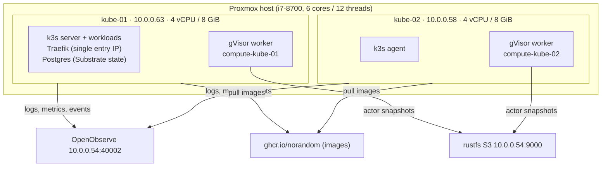

# What we have: the kube-ax cluster

**In one sentence:** two small Proxmox VMs run NixOS and k3s, configured entirely from this repo by
pyinfra. On top runs **AX on Agent Substrate**, which executes agent and compute tasks in **gVisor
sandboxes**, spread over both machines, with telemetry going to OpenObserve.

## The layers, bottom to top

| Layer | What | Version | Defined in |
|---|---|---|---|
| Hardware | 2 Proxmox VMs, CPU type `host` (AVX2 + nested KVM), 8 GiB with balloon min = max | — | Proxmox UI ([adding-nodes](adding-nodes.md)) |
| OS | NixOS, one flake for every node; per-node differences come only from `node.json` | 26.05 | `nix/` |
| Disk | GPT → LVM `pool`: `root` 20G, `containerd` 35G, `storage` 30G, rest free | — | `nix/disko.nix` |
| Kubernetes | k3s with SQLite datastore, flannel host-gw, both nodes run workloads | 1.36.4 | `nix/modules/k3s.nix` |
| Entry point | Traefik + servicelb, **only on 10.0.0.63** | bundled | `nix/modules/k3s.nix` |
| Agent platform | Agent Substrate (`ate-system`): API, controller, router, egress gateway, Postgres, node agents | main `715f2daa` (v0.3.0-34) | `platform/substrate/` |
| Agent orchestration | AX (`ax-system`): server, controller, Redis | v0.3.1 | `platform/versions.toml` |
| Workers | one gVisor WorkerPool per node (`ax-workers`), 3 vCPU / 3 GiB each, **one task at a time** | — | `platform/substrate/workerpools.yaml` |
| Observability | OpenTelemetry Operator + OpenObserve collector (agent per node + gateway) | chart 0.5.0 | `platform/openobserve/`, `scripts/openobserve.sh` |
| CI | Gitea Actions runners for code.because-security.com: pod jobs + Docker-in-Docker, below AX in priority ([gitea-runner](gitea-runner.md)) | runner 4.1.0 | `platform/gitea-runner/` |
| Automation | pyinfra in a uv venv, `just` recipes | pyinfra 3.10 | `deploys/`, `justfile` |

## How work flows through it

1. You (or another agent) run `ax apply -f task.yaml` with the restricted `ax-deployer` kubeconfig.
   The CLI port-forwards to `ax-server`.
2. AX turns each **Task** into one Substrate **actor**: a sandboxed process running your command.
3. Substrate places the actor on a **randomly chosen** gVisor worker. With one worker per node, tasks
   spread across both machines. Fan-out is "submit N tasks" (`just ax-fanout`).
4. The task's output appears in the worker's log (`just ax-logs TASK`) and in OpenObserve (`k3s_logs`).
5. Outbound traffic from actors leaves through Substrate's egress gateway. Each task gets the host list
   of its name prefix (`platform/substrate/egress-routes/`), HTTPS only; everything internal stays
   unreachable ([AX guide](ax-guide.md#7a-network-access-from-tasks)).
6. The reaper (`tools/ax-reaper`) deletes `ousast-engine-*` tasks 10 minutes after their command exits.

## Where state lives

| State | Where | Lost if… |
|---|---|---|
| Node configuration | this repo (`nix/`, `inventory.py`, `host_network/`) | never: rebuildable |
| Kubernetes objects | k3s SQLite on kube-01 | kube-01's disk is lost |
| Substrate actors and snapshots metadata | Postgres on kube-01 (`storage` LV) | kube-01's disk is lost |
| Actor snapshots | rustfs bucket `k3s-ate-snapshots` (10.0.0.54) | the rustfs host is lost |
| AX task list | Redis in `ax-system`, **not persisted** | ax-redis restarts |
| Secrets | `secrets/` (gitignored, local) | this workstation is lost |
| Kubeconfigs | `kubeconfig/` (local, gitignored) | regenerate: `just kubeconfig`, `just ax-deployer` |

## Known limits (honest list)

- **One control-plane node.** If kube-01 is down, the API and the 10.0.0.63 entry point are down; running
  pods on kube-02 continue.
- **AX v0.3.1** has no auth, no fan-out, never marks tasks finished, and keeps tasks in non-persistent Redis.
  See [ax-guide](ax-guide.md#8-limitations-to-know-ax-v031-on-this-cluster).
- **AX keeps the old Substrate API address** when the API server pod is replaced; restart AX
  ([upgrading](upgrading-substrate.md#the-one-surprise-clients-keep-the-old-api-server-address)).
- **Substrate is pinned before upstream #2105** until AX stops sending `onResume` (spec Requirement 22).
- **No alerts yet**; disk and health checks run with `just verify` ([guardrails](guardrails.md)).
- **Footprint reporting** (`just footprint`) is not built yet. Numbers in these docs were measured by hand on
  2026-10-04.

**You know it works when** `uv run just verify` passes: 46 checks covering memory, disk space and the
image cache, CPU features, zram, sysctls, node readiness, pod spread, ingress through 10.0.0.63 to a pod on
kube-02, and agents not exposing the entry point.
